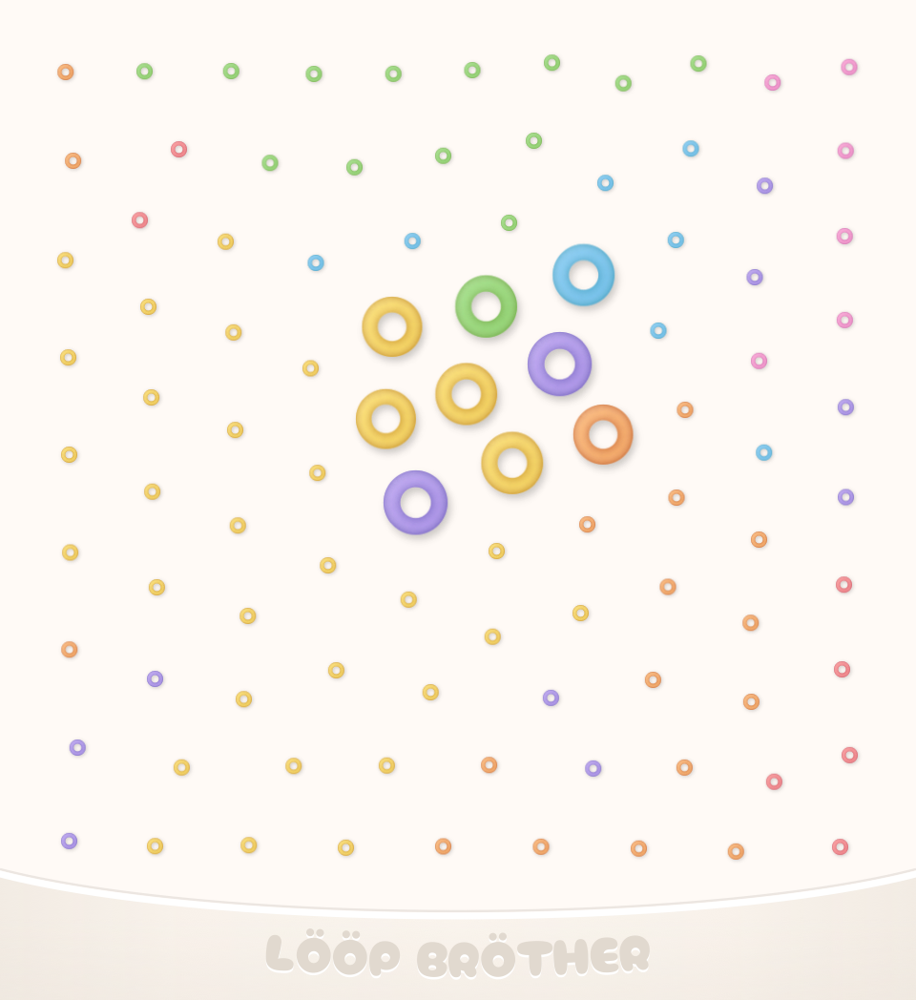

# LÖÖP BRÖTHER

A drum break instrument: 97 classic breaks laid out on a pad by
how they sound, played in time with your song. Move the circle across the
pad and the breaks under it play together, blended by how much of each one
it covers, always in sync with your DAW's tempo. It works as a VST3 plugin
and a standalone app on macOS and Windows, and as an Audio Unit on macOS.
In plugin lists it appears as **LOOP BROTHER** by **minus**.

  

## Playing it

Load it as an instrument on a track and press play in your DAW.

- **Each ring on the pad is a break.** Breaks that sound alike sit close
  together and share a colour. The big rings show the breaks under the
  circle, and they pulse with the music.
- **Click or drag** to move the circle. Changes land on the next 16th note,
  so they stay in time.
- **Shift-drag**, or **drag with the right mouse button** (a two-finger
  click on a trackpad), sizes the circle like a knob: right or up makes it
  bigger, left or down smaller. A bigger circle blends more breaks, up to
  half the pad. Press the other button mid-drag to switch between moving
  and sizing.
- **Option-drag** (Alt on Windows) moves the circle 8 times slower, for fine
  adjustments, and the change sounds at once instead of on the next 16th.
- **Hold Command** (Control on Windows) with the pointer over the plugin to
  mute it; the rings under the circle turn grey while it's muted.
- **Any MIDI note** restarts the breaks from their first beat.
- **With your DAW stopped,** hold the pad or a MIDI note to listen from the
  start.
- **Resize the window** by dragging its edges or corners.
- **Make the circle as big as it goes** and you may get company.

The standalone app has no song to follow, so it plays at the breaks' own
tempo, 162 BPM.

## Installing

Download the installer for your system from the
[**Releases** page](https://github.com/minusro/loopbrother/releases).

The installers aren't signed yet, so macOS and Windows warn you that they
don't know who made them. The steps below get past those warnings.

### macOS

macOS 11 or later, Apple silicon or Intel.

1. **Download** `LOOP-BROTHER-<version>-macos.pkg`.
2. **Open it.** macOS says it can't check the package for malicious
   software. Click **Done** (not *Move to Bin*).
3. **Allow it.**
   - **macOS 15 or later:** open **System Settings → Privacy & Security**,
     scroll down to the message about `LOOP-BROTHER-….pkg`, click
     **Open Anyway**, then confirm with your password.
   - **macOS 14 or earlier:** Control-click (or right-click) the package,
     choose **Open**, then **Open** again.
4. **Install.** To leave out a format, click **Customize**. The installer
   puts:
   - the VST3 in `/Library/Audio/Plug-Ins/VST3`;
   - the Audio Unit in `/Library/Audio/Plug-Ins/Components`;
   - the app in `/Applications`.
5. **Rescan your plugins** in your DAW, or restart it. Logic Pro checks new
   Audio Units on its next start.

The plugins and the app then open like any other, without further warnings.

**To uninstall,** delete `LOOP BROTHER.vst3`, `LOOP BROTHER.component` and
`LOOP BROTHER.app` from the folders above, and the folder
`/Library/Application Support/minus/LOOP BROTHER`.

### Windows

Windows 10 or 11, 64-bit.

1. **Download** `LOOP-BROTHER-<version>-windows.exe`. If your browser says the
   file isn't commonly downloaded, choose **Keep**.
2. **Run it.** When Windows shows *Windows protected your PC*, click
   **More info**, then **Run anyway**. Allow it to make changes when asked.
3. **Install.** The installer puts:
   - the VST3 in `C:\Program Files\Common Files\VST3`;
   - the app in `C:\Program Files\minus\LOOP BROTHER`, with a Start menu
     entry.
4. **Rescan your plugins** in your DAW, or restart it.

**To uninstall,** use **Settings → Apps → Installed apps → LOOP BROTHER →
Uninstall**.
